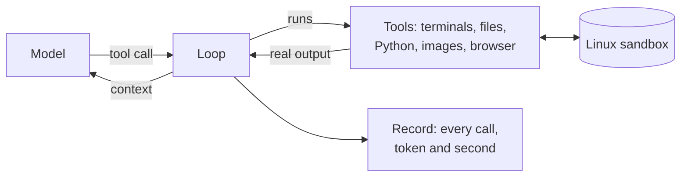

# Core Agent

**A lean, cheap agent: 26% cheaper than Codex on Terminal-Bench 2.1, on the same model.**

[](https://github.com/mohamud1961/core-agent/actions/workflows/ci.yml)

Core Agent does real work on a computer. You give it a job in plain words, and it works in a Linux sandbox with
terminals, files, Python, images and a browser until the job is done. It is plain Python with no agent framework
underneath, and it records every call, token and second it spends.

- **Cheap:** 26% cheaper than Codex on Terminal-Bench 2.1, same model, same passes.
- **Capable:** passes hard jobs graded by hidden tests, from EU bank capital rules to a CAD part from a drawing,
  for 5 to 20 cents each.
- **Reliable:** crash-safe tools, a full record of every run, and over 1,100 tests on every push.

**Contents:** [Core vs Codex](#core-vs-codex) · [Try it in 60 seconds](#try-it-in-60-seconds) ·
[Run it on your own task](#run-it-on-your-own-task) · [Why it is cheap](#why-it-is-cheap) ·
[Real jobs](#real-jobs) · [How it is built](#how-it-is-built)


## Core vs Codex

Core Agent and Codex, both on GPT Luna at max effort, run side by side on Terminal-Bench 2.1 and graded by the
benchmark's hidden tests.

| | Core Agent | Codex |
|---|---|---|
| Tasks passed | **25/25** | 25/25 |
| **Cost** | **$0.416** | $0.563 |
| Median time per task | **167 s** | 185 s |

**26% cheaper, with the same passes.** Core was cheaper on 19 of the 25 tasks and took fewer steps on most, for
example 39 steps against Codex's 92 to build the CompCert C compiler.

Per-task results, setup and the script: [benchmarks/](benchmarks/).

## Try it in 60 seconds

Needs Python 3.12+ and [uv](https://docs.astral.sh/uv/).

```sh
git clone https://github.com/mohamud1961/core-agent && cd core-agent
uv sync --frozen
uv run python examples/offline_smoke.py
```

This runs the real agent loop with a scripted model in place of an API, so it needs no key and no network. It
writes a file through Core's real tools and prints:

```
{"status": "finished", "actual_file": "hello from installed Aether\n", "network_calls": 0, "attempts": 2}
```

Tests: `uv run pytest -q -m "not sweep"`. Linux-only tests (PTY, Docker, process cleanup) skip on macOS.

## Run it on your own task

Core works inside a running Docker container. Point it at any OpenAI-compatible or Azure OpenAI endpoint:

```sh
export AETHER_FW_GLM_53_FLASH_ENDPOINT=https://your-endpoint
export AETHER_FW_GLM_53_FLASH_KEY=your-key
export AETHER_FW_GLM_53_FLASH_DEPLOYMENT=your-model
export AETHER_CORE_API=openai          # or azure (the default)

docker run -d --name job python:3.12 sleep infinity
echo "Write a CSV of the 10 largest files under /usr with their sizes." > task.txt
uv run python -m aether.core.local_run --container job --task-file task.txt --logs logs/
```

`logs/` then holds the full record: every model call, tool call, token count and timing. For benchmark runs Core
plugs into [Harbor](https://github.com/laude-institute/harbor): install the `harbor` extra and select
`aether.core.harbor_agent:AetherCoreAgent`.

## Why it is cheap

- **Cache-stable context.** The start of every request stays identical, so the provider's cache serves most of
  it at a tenth of the price. This alone roughly halved cost per run.
- **Small requests.** Core keeps the working context within a budget instead of replaying the whole history, so
  it needs fewer, smaller requests than Codex for the same job.
- **State written once.** Facts about the run are written once instead of rewritten every turn. This cut cost per
  run to 0.52× and 0.76× on two task sets, with the same passes.
- **Long commands keep running.** Up to eight named terminals keep slow jobs going in the background while the
  model works on something else.

Each of these started as an experiment behind a switch and stayed only because the numbers held. The record:
[EXPERIMENTS.md](EXPERIMENTS.md).

## Real jobs

Real runs on Terminal-Bench with GPT Luna, graded by hidden tests Core never saw. Costs at list prices.

| Job | Time | Cost |
|---|---|---|
| **Bank capital calculation** under EU rules (SA-CCR, CRR3): 13 trades, a collateral agreement, disputed margin calls, results file and a formula-driven Excel workbook | 17m 15s | $0.085 |
| **Design file from a picture**: every element's position, size, layering and text style, rendered back pixel-identical | 26m 42s | $0.085 |
| **3D part from an engineering drawing**: a parametric FreeCAD model built from dimensions read off a PNG | 12m 34s | $0.051 |
| **Robot trajectories in PyDrake**: walking, jumping and running for a simulated biped, obeying contact physics | 33m 45s | $0.198 |
| **Invoices from a folder of scans**: 17 mixed documents read with OCR, 10 invoices sorted out, totals and VAT | 5m 44s | $0.021 |
| **COBOL to Python**: rewritten and checked byte for byte against the original on the same inputs | 4m 20s | $0.028 |

Steps and checks for each, plus two more: [RUNS.md](RUNS.md). These are chosen successful runs; the hardest tasks
are not solved every time.

## How it is built



The model decides what to do and when the job is finished. Core runs the actions, reports exactly what happened,
keeps the context within budget, and records everything.

| Part | What it does | Where |
|---|---|---|
| Loop | Calls the model, runs its tool calls in order, enforces the deadline | [loop.py](src/aether/core/loop.py) |
| Terminals | Up to eight named shells that survive long commands | [terminal.py](src/aether/core/terminal.py) |
| Files | Line-numbered reads, exact edits, atomic writes | [files.py](src/aether/core/files.py) |
| Python, images, browser | A persistent Python session, image viewing and cropping, a headless browser | [repl.py](src/aether/core/repl.py), [images.py](src/aether/core/images.py), [browser.py](src/aether/core/browser.py) |
| Context | Keeps long runs inside budget, with a cache-stable request prefix | [context.py](src/aether/core/context.py), [clm.py](src/aether/core/clm.py) |
| Provider | Streaming calls, bounded retries, honest handling of dropped streams | [provider.py](src/aether/core/provider.py) |
| Record | Every model attempt logged before it is sent | [calls.py](src/aether/core/calls.py) |
| MCP | Connects to external tool servers | [mcp.py](src/aether/core/mcp.py) |

About 23,000 lines of Python in 120 modules, each under 500 lines, with 174 test files. Tested in a plain Linux
container on every push.

**Built for production failures, not just demos.** A dead tool server no longer freezes later calls, a lost
reply can no longer run a command twice, and writes can no longer land at the wrong path. Each fix came from a
real run and has a test that fails without it: [docs/LESSONS.md](docs/LESSONS.md).

How changes are made and judged: [BUILDING.md](BUILDING.md). Design notes:
[docs/ARCHITECTURE.md](docs/ARCHITECTURE.md).

## Limits

- One model at a time, tested mainly with GPT Luna.
- The offline tests prove the mechanics, not task skill. Task results come from the real runs above.

## Built with

Python 3.12, the OpenAI SDK, asyncio, Docker, Harbor, Playwright, MCP and Pillow. Ideas adapted from public agents
are credited in [THIRD_PARTY_NOTICES.md](THIRD_PARTY_NOTICES.md).

Core Agent comes out of [Aether](https://github.com/mohamud1961/Aether), a research programme on what an agent
harness should add to a model.
